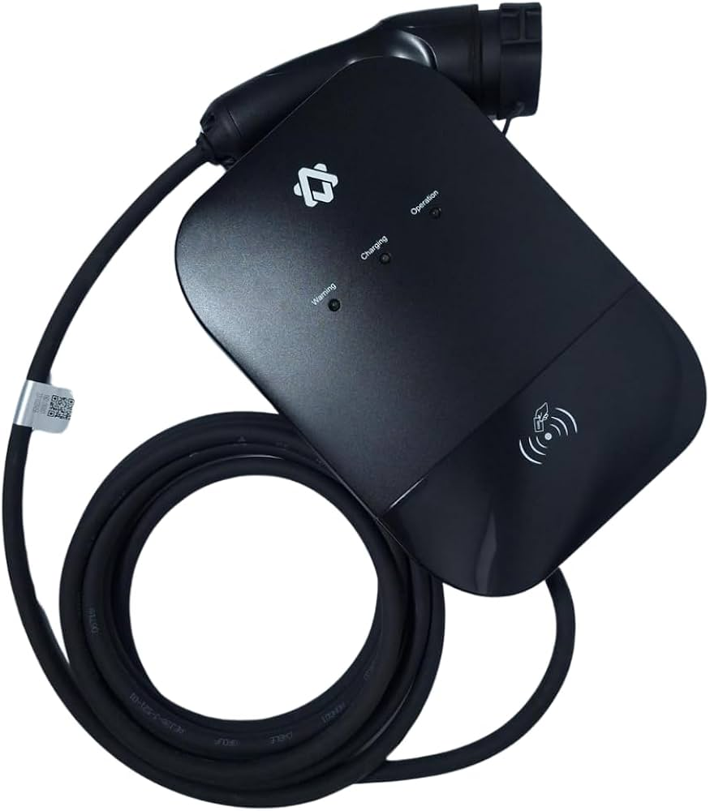

# Zeeda EV Charger — Home Assistant integration

[](https://my.home-assistant.io/redirect/hacs_repository/?owner=equake&repository=hass-zeeda&category=integration)

[](https://www.home-assistant.io/)
[](LICENSE)

Control and monitor a **Zeeda** Wi-Fi EV charger from Home Assistant, talking
directly to the Zeeda cloud with your app account — no extra hardware, no local
flashing, no cloud bridge.

<p align="center">
  
</p>

The charger is made by **Zeeda** (Shanghai Zhida Technology / 上海挚达科技发展有限公司,
app developer "ZHIDATECH") and is sold rebadged by several car makers — it ships
as a "gift" with vehicles from **GWM** and **BYD**, among others. The common
retail model is the *Zeeda Energy G Series 3.5–7 kW EV Charger, Type 2, IP55*.

> If your charger is managed by the official **ZEEDA** app, it should work with
> this integration, regardless of the car brand that handed it to you:
> - App Store: https://apps.apple.com/br/app/zeeda/id1504210161
> - Google Play: https://play.google.com/store/apps/details?id=com.wxzd.zdjczb

## Features

- **Status** sensor (standby, plugged in, charging, waiting, finished, scheduled,
  fault, offline) plus **online**, **charging** and **fault** binary sensors.
- **Live meter**: charging power (kW), session energy (kWh), current (A),
  voltage (V) and session duration.
- **Start / stop charging** (switch).
- **Charging current** (number) — adjustable **live**: if a session is running,
  the integration pauses it, changes the amperage, and resumes, so you can do
  dynamic power control with the car plugged in (the hardware only accepts a
  current change while not actively charging).
- **Charging mode** (select): *via app or card*, *plug and charge*, *scheduled*.
- Diagnostics: firmware, Wi-Fi network.

## How it works

The integration mirrors the official app:

1. Asks the Zeeda bootstrap server which **regional backend** serves your time
   zone, then uses it (e.g. Brazil → `sp-device.zdenergy.com`). Your account
   only exists on its regional server, so this step matters.
2. Logs in with your **email + password** (AES-encrypted exactly like the app).
3. Keeps a **real-time WebSocket** per charger for push updates and commands;
   if the socket drops, it reconnects automatically (retrying every 30 s), with
   a light REST poll (default 60 s) as a safety net and the source for
   slow-changing data.

See [`docs/PROTOCOL.md`](docs/PROTOCOL.md) for the reverse-engineered API.

## Install

### HACS (custom repository)

1. HACS → ⋮ → *Custom repositories* → add this repo, category **Integration**.
2. Install **Zeeda EV Charger**, restart Home Assistant.
3. *Settings → Devices & services → Add integration → Zeeda*, enter your ZEEDA
   app login (email — or phone, best-effort) and password. The **time zone**
   defaults to Home Assistant's; change it to your account's region if HA runs
   elsewhere (e.g. in the cloud), since it selects the Zeeda regional server.

### Manual

Copy `custom_components/zeeda` into your HA `config/custom_components/`, restart,
then add the integration from the UI.

## Options

- **Status poll interval** — fallback polling cadence; the real-time WebSocket is
  the primary source, so this can stay relaxed.

## Testing the API without Home Assistant

`helpers/test_client.py` is a standalone script that logs in and dumps your
chargers and live status — handy to confirm credentials/connectivity:

```bash
pip install pycryptodome        # or: pip install cryptography
python3 helpers/test_client.py --email you@example.com --password 'yourpass' -v
```

## Running the test suite

The automated tests use synthetic-only encryption inputs and do not require a
Zeeda account:

```bash
pip install -r requirements_test.txt
python -m pytest -q
```

## Releasing

Update `version` in `custom_components/zeeda/manifest.json`, merge the change,
then push a matching `v<version>` tag (for example, `v0.1.0`). GitHub Actions
validates the tag, runs Ruff, pytest and Hassfest, then creates a GitHub Release
with generated release notes. HACS can discover the update from that release.

## Brand icon

The integration ships its icon under `custom_components/zeeda/brand/`
(`icon.png` 256×256 and `icon@2x.png` 512×512, both RGBA). Home Assistant 2026.3+
serves it via the Brands Proxy API (`GET /api/brands/integration/zeeda/icon.png`),
so the Zeeda logo shows up in **Settings → Devices & Services** without any
submission to the [home-assistant/brands](https://github.com/home-assistant/brands)
repository.

## Wi-Fi setup (get the charger online first)

Before Home Assistant can see it, the charger must be joined to your Wi-Fi via
the official ZEEDA app. GWM Brazil has a clear Portuguese walkthrough:

- Original: [Aplicativo Zeeda Energy — Instruções e utilização (GWM Brasil, pt-BR)](https://www.gwmmotors.com.br/content/dam/gwm/pages/br/pt/service/manuais/manuais/aplicativo-zeedaenergy-instrucoes-e-utilizacao.pdf)
- Local backup: [`docs/manuals/gwm-zeeda-app-pt-br.pdf`](docs/manuals/gwm-zeeda-app-pt-br.pdf)

## Notes & limitations

- Unofficial. Not affiliated with Zeeda, Zhida, GWM or BYD. The cloud API is
  undocumented and may change at any time.
- One Home Assistant config entry = one Zeeda account; every charger on the
  account is added as its own device.

## License

MIT — see [LICENSE](LICENSE).
